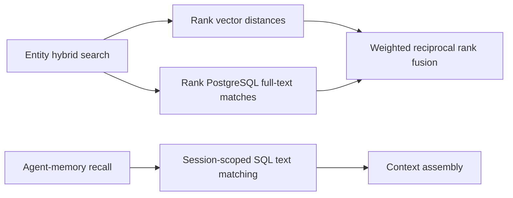
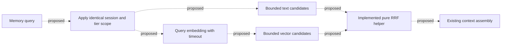

# Hybrid recall: implementation and next steps

DarshJDB is alpha (v0.4.0). Entity hybrid search and agent-memory recall currently use different retrieval paths. This brief applies the six Argon design discussions reviewed on 2026-10-20 to the source; their example benchmark data is not a DarshJDB performance measurement.

## Today



`packages/server/src/api/rest.rs` implements entity search using the existing `triples` and `embeddings` tables. Its two ranked candidate lists feed weighted reciprocal rank fusion (RRF). Deterministic input and output tie-breaks make equal-score results reproducible. Each entity contributes once per branch; weights must be finite and nonnegative, with at least one positive branch. Omitted weights default to 1 for each branch. The hybrid endpoint accepts limits from 0 through 1,000; larger values return HTTP 400. Each candidate window is at most four times that limit.

`packages/server/src/agent_memory/repo.rs::semantic_recall` searches `memory_entries` within one session and the episodic/semantic tiers using `lower(content) LIKE`. It orders by content length and creation time. Embedding columns and workers do not make this path vector retrieval. The working, episodic, semantic and archival tiers must not be conflated with search modes.

## Implemented foundation, proposed retrieval

`packages/agent-memory/src/hybrid_recall.rs` is a standard-library-only fusion module. It accepts ranked text and vector `MemoryHit` lists, adds `1 / (k + rank)` for each branch, preserves earliest ranks and raw scores, orders exact ties by ID, and applies the output limit after merging. Raw scores never determine the fused rank. Duplicate positions consume input ranks; the existing entity endpoint instead compacts duplicate entities before ranking, preserving its previous semantic-branch behavior.

Non-finite or negative `k` is normalized to zero; zero is valid. Very large finite values can collapse rank differences at floating-point precision, but their reciprocals do not necessarily become zero. Raw NaN scores remain metadata, so ordinary floating-point `PartialEq` behavior still applies. The retrieval adapter must validate provider values before serializing them.



The dotted connections are proposed, not integrated. Start with the actual `memory_entries` schema. An EAV migration needs a separate schema and history design; the illustrative `_ddb_eav_triples` and `_ddb_entity_vectors` tables from a draft do not exist here.

Before wiring memory retrieval, verify extension and table readiness per database, embedding dimension and finite values, provider timeout behavior, and identical session/tier filters in both branches. Preserve lexical candidates without embeddings. Define explicit fallback reasons for unavailable vectors and test that cross-session records cannot enter either candidate list. Avoid a process-global readiness flag that can become stale or leak state across database pools. A healthy server process alone does not establish migration success.

## Evaluation before performance claims

The discussion's sample at 10,000 records reports text recall@10 of 0.52 at 31 ms p95 and hybrid recall@10 of 0.75 at 62 ms p95. Those are illustrative inputs. They neither prove a latency regression in this repository nor establish why a real system would be slow. The sample hybrid result exceeds the stated 40 ms p95 budget.

Use a labeled, reproducible query corpus and record dataset size, query count, hardware, provider, index configuration and candidate limits. Measure query embedding, text retrieval, vector retrieval, fusion and total latency separately. Sweep bounded candidate counts (for example 25, 50 and 100) and evaluate recall and latency together. Test cold/warm runs, missing embeddings and provider failure. Choose an index or gating policy only after those measurements; neither quantization nor lexical gating is justified by the sample alone.

## Local validation

The pure module can be tested without PostgreSQL or external dependencies:

```sh
rustc --edition 2024 --test packages/agent-memory/src/hybrid_recall.rs -o /tmp/darshjdb-hybrid-recall-tests
/tmp/darshjdb-hybrid-recall-tests
cargo test --locked -p ddb-agent-memory hybrid_recall
cargo test --locked -p ddb-server search_unit_tests
```

Tests cover exact ties, duplicate votes and raw-score preservation, empty branches, limits, invalid `k`, and non-finite metadata. Database-scoping and retrieval-quality tests belong with the proposed adapter. Run checks locally; GitHub Actions remains disabled.

## What this does not do

This change does not add vector retrieval to agent-memory recall, migrate memory to EAV, call an embedding provider from the fusion module, establish production readiness, or claim measured recall/latency improvements. It does not change the deployment at db.darshj.me.
